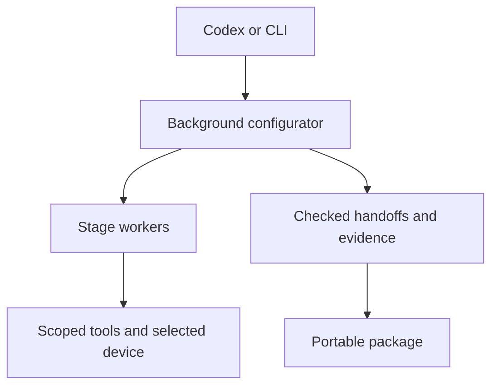
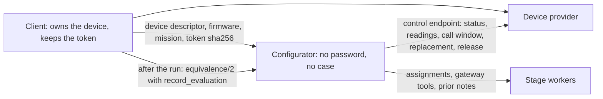

# Accepted design

Current runs use `assistive/1`: stage handoffs carry notes, device differences drive bounded repair, and one final equivalence verdict follows fresh reuse. The [amendment below](#assistive-protocol-amendment--2026-10-07) governs current behavior; the original design records the earlier gated protocol. The [section of 2026-11-19](#a-package-is-data--2026-11-19) says what a package holds, how it runs and how it is served.

## Original design — 2026-10-03

Confirmed 2026-10-03. Install Generative Driver, connect a supported device, state an objective, and get a portable driver with evidence. The core targets native macOS and Windows 11+. Optional analysis tools may use containers.

## Workflow

Acquire → interpret → probe → ground → emit → reuse. One stage runs at a time. A fresh agent must use the emitted package successfully. Worker completion alone never advances a stage.

The configurator owns workers, exclusive device access and durable runs. UI reconnection uses the same run ID. The configurator launches the configured Codex CLI under the stage contract and records the runtime, provider and model identities separately. State and outputs live outside the installed package.

Assignments, reports, acceptance checks and routing are separate records. Accepted artifacts are immutable and hash-pinned. Model defects return to interpretation; host and operator faults wait for the relevant correction. Diagnostic feedback allows at most two repairs before emission.

## Device access and recovery

The operator selects bindings and effect grants. Operations are bounded. Cancellation stops dispatch and records outstanding outcomes; an interrupted write stays uncertain and is never silently repeated.

Before the final verdict, a supplied device may be replaced only when every unresolved effectful dispatch has trusted, completed model-failure evidence. The old process must be confirmed stopped, a distinct replacement independently verified at its initial state, and repair budget available. Retain failed commands and historical uncertainty. Physical or attached sessions, unknown/host/operator failures, cancellation, lost ownership, failed replacement verification and exhausted budgets remain blocked.

Blind interpretation receives its prepared inputs and generic tools. Fresh reuse receives only the package, objective and permitted operating information. Exclude the developer chat, private answers and prior candidates from fresh worker inputs; authorized repair feedback stays within its run. Record restrictions actually enforced.

## Repository and integrations

`src/generative_driver/` contains the configurator, tools, runtime and packaged resources. `plugins/` supplies the Codex integration. `docs/` and `tests/` hold guides and behavior tests. Original code is Apache-2.0. Preserve third-party notices and the source research checkout. Import only selected reusable material.

Generic tools and skills ship to workers. The Codex plugin connects to the configurator through MCP. Follow [setup](setup.md) through runtime configuration and dependency checks before a device run.

## Driver contracts and generated MCP — 2026-10-28

The section [A package is data](#a-package-is-data--2026-11-19) replaces the packaging this section describes: the formats, the files of a package and how a package is served.

The [extension guide](extending-drivers-and-mcp.md) and [ADR 0002](adr/0002-driver-contract-and-generated-mcp.md) define the public driver contract, declarative protocol and supported application SDK. The contract supplies operation/field meanings, caveats and executable preconditions. Device-specific executable plugins remain outside the driver format; new behavior uses a shared runtime capability or a higher-level application tool.

Format-2 emission freezes the contract, protocol, executable projection and derived MCP catalog. Fresh reuse uses that catalog through configurator-owned dispatch, with or without a supplied device. Current `assistive/1` handoffs retain notes; observed generated-tool use of the unchanged package is reported beside the final equivalence, not inside it. Historical format-1 packages and reports retain their original meaning.

## Evaluation

Functional equivalence means expected outputs and effects for supported inputs within declared tolerances; candidate code need not resemble reference code. Protocol validity alone proves neither meaning nor safe state sequencing. Keep failed, blocked, unrun and inapplicable stages visible.

## Public test seams

Use one failing behavior test and its implementation at a time for code changes.

| Seam | Required behavior |
|---|---|
| Installed CLI/MCP | Clean install outside checkout, paths with spaces, the smoke, optional-dependency reporting |
| Configurator/workers | Correct context/tools; checked advancement; duplicate/stale/tampered input rejection; durable reconnect, cancellation, recovery and fresh reuse |
| Runtime/package | Binding and grant checks before I/O; exclusive access; relocation, replay, tamper rejection; no automatic uncertain-write retry |

Exercise actual public process/protocol boundaries. Controlled workers, clocks and devices support deterministic tests but remain labelled substitutes. Qualify native macOS/Windows releases separately from optional backends and physical devices.

## Assistive protocol amendment — 2026-10-07

New runs record `protocol: "assistive/1"`. For these runs this amendment supersedes the checked stage progression above: "deterministic checks control whether reports become accepted handoffs", "assignments advance only after checked reports" and diagnostic observations as repair input. Earlier runs keep their recorded meaning; resuming one is refused.

The configurator coordinates; for a run on a supplied device, a client of the interface plays the operator:

- **Every stage hands off.** It passes on its observed artifacts, their hashes and a hashed `notes.json` (`stage-notes/1`): the worker's own checks, including failed and not-run ones, the configurator's truth-free checks, dropped claims, tool refusals and open questions. A stage that produced nothing usable hands off empty with its notes, and the next stage starts. Generic emit receives the latest interpreted model that wrote a successful probe record, from probe or ground, with that record, and hands off only a package the configurator observed: one `emit_package` built in its assignment, hashed when the tool returned, or bytes it gave to `emit_check`; a worker report may name which package, never its hash. Emit on a supplied device hands off only a package `emit_package` built in its assignment, by the hash recorded when the tool returned, that passes `emit_check`: a package the worker wrote or changed is dropped with a note and never graded. Fresh reuse receives only the emitted package, the objective and permitted operating information, never notes.
- **Only safety, integrity, operator and host faults stop a run.** Safety covers effect grants, the reset rule, uncertain writes and binding conflicts. Integrity covers a recorded or observed hash that changed and a changed sealed input. Operator covers cancellation, budget, a runtime that cannot start and a missing binding. Host covers a crashed runtime or configurator; it is resumable. Worker report content never stops a run.
- **The device drives repair.** Differences between the model and what the configurator observed on its own device connection during probe or ground return to interpret within the repair budget, together with the defects the configurator's own validation finds in the assigned model (structural failures are refused by the runtime; candidate response checks also reject a receive bound that cannot contain its declared rejection and completion, and the managed gateway refuses that candidate before contact). Each probe record a stage hands on is bound in its notes to the model that wrote it, and a later stage compares a record with its assigned model only when that model wrote it; a record of a worker's own variant says nothing about the assigned model. A live `probe_run` or `interface_execute` runs a copy of its model directory that the configurator makes outside the worker's workspace before it reads the model, refusing a directory that holds a symlink; the bytes the gateway classifies, hashes and attributes are then the bytes that run, whatever the worker writes meanwhile. A live `emit_test_live` pins the package manifest the gateway read with the model it classified, so a package swapped in meanwhile is refused before contact. The gateway reads the model of every device dispatch as the runtime does and refuses one its strict bounded reader cannot load, and an effectful operation of an interface model that fails validation, before it marks the dispatch uncertain; `probe_run` and `interface_execute` declare the checks they make before the transport opens (model bytes, validation, operation, sample count, evidence bound, replay fixture, and a register probe's binding, grants and a model the register runtime cannot load or drive) as refusals with `transport_open_attempted: false`, so none of these leaves an effect to reconcile; nor does a host fault a tool declares before contact. Probe and ground workers are not given `model_validate`, which may write beside the model it checks. When the budget is spent the run continues with the best revision.
- **One final verdict.** After reuse the run records `equivalence: {equivalent, basis, checks, diff, mission}` once, as verdict `<run_id>:final`, and ends `completed` whether or not the driver is equivalent. A restart or resume never grades again, cancellation never replaces the completed status, and a sealing or cleanup failure after the verdict is recorded as an event without erasing it; an uncertain effect still blocks for safety. A posted verdict (basis `evaluator`) grades the frozen driver's behavior alone: fresh reuse is reported beside it in `mission`, never in `checks`, and `mission.passed` is true only if the fresh worker's mission passed and, for generated MCP reuse, the owner's proof of that reuse holds. A generic run's verdict is labelled `self-evidence` and is not an independent grade. It is equivalent when the emitted package passed `emit_check` replay of the recorded device exchanges, every live operation of fresh reuse succeeded, and at least one of them ran the frozen package with `emit_test_live` on the configurator-supplied connection, including a function beyond its identity operation, that is an operation with a step that asks the device something identity's own steps do not, compared by what reaches the device (op and tx, and a USB control transfer's setup and requested length): identity alone is not evidence of function, nor is an operation that only waits or repeats identity's requests, however it reads or checks the reply. A replay is one of recorded device exchanges only when the package's probe evidence was recorded live; a replay of exchanges the worker supplied does not count, nor does a seeded package-versus-model check, which compares a package with its own model, not the device. The frozen package ran when the configurator hashed its bytes before dispatch and the snapshot the tool executed carries the frozen manifest. Fresh reuse is every reuse attempt that received the frozen package, including one that stopped and was resumed; each attempt's notes judge its live operations by the same rule. A call or operation refused before the device was contacted, as the runtime or the tool declares, is not a live operation; a host fault the tool declares before contact (such as a snapshot copy it cannot read back) is no refusal and leaves the verdict unscored, and any other toolchain error may have followed device contact and leaves it unscored too; a tool that cannot record what the device did still returns it. A host fault in the configurator's own `emit_check` stops the run for the host at emit, resumably, and never rejects the package. Only a named failure outside the package bytes is a host fault (a file or process failure around the check, such as reading back its own snapshot copy, or a replay process that ends without a result or cannot read the verified snapshot, an import, memory or a timeout); a package the worker wrote, however malformed, is rejected, including a register converter that will not load, and the check keeps its records outside the worker's workspace. When the operator's grants permit no function of the frozen package (each needs an effect that was not granted, or its channel resets the device on open and the reset was not granted, so its runtime refuses every operation), fresh reuse cannot test one and the verdict is unscored, not not equivalent. A package whose runtime needs the reset grant refuses a live probe of its bytes too, so its missing replay of device exchanges is that limit as well. So is it when the gateway refused every connection to the run's device for the operator or the host, from which no live probe could be recorded either: no device bound, or a serial device without a reset grant that was observed resetting on open or whose every listen failed for the operator, the host or the transport. These limits excuse only the one package that passed `emit_check` without a replay of device exchanges; no driver emitted, a candidate `emit_check` rejected offline, or several packages handed off is not equivalent whatever the device access. Listening needs no grant, so a serial device no worker listened to is the pipeline's own omission and excuses nothing. Reachability is judged by the run's binding state as of fresh reuse, so an operator observation recorded later never turns a refused connection into a verdict about the driver. A failure the runtime attributes to the driver after the device opened makes the run not equivalent when the operation ran the frozen bytes (the package, or its driver directory as a model); a failure of other bytes, an operator, host or transport fault, or a dispatch whose result was never recorded, leaves it unscored. A run stopped after fresh reuse resumes to finalize without a budget or device lease, since finalize contacts no device; a restart completes a run on a supplied device there awaiting its verdict unless an effect is uncertain, and an uncertain effect on a run awaiting its grade blocks it for safety until the operator reconciles it and resumes. For a generic run, a host failure to read the frozen package at finalize stops the run for the host instead of grading the driver. A gateway call dispatches only while its assignment is the run's active one, and a stage is observed and committed only after every call of it has left the gateway.
- **Recovery.** At any stage, the verified replacement of a supplied device, through the request `replace`, after a write the runtime attributed to the model commits with that stage's handoff, together with the replacement's session and binding, whose lease replaces the stopped device's; this resolves the write without re-executing it; the recovery uses a repair only when the stage's device difference revises, so a spent budget never refuses it, and a recovery that does not commit is recorded as failed and leaves the write uncertain. A write the frozen driver fails during fresh reuse is evidence about the driver: reuse's handoff advances and the verdict comes after the run.
- **The configurator holds no password.** The configurator holds no password, recipe or truth and knows no case: it refuses password and emulator options and a start that names a case, holds the run to the supplied firmware by its hash, which the device's descriptor must name too, and reaches the device only through the provider's control endpoint (status, readings, the paused-between-calls window, replacement and release). Live calls take turns: each takes an instrument reading before and after the call, which runs inside the window. A provider that cannot be reached before a call refuses it, leaving nothing uncertain, and the stage stops for the operator. The run releases the device when it ends, once no live call is inside its window; the client stops it.
- **One posted verdict after the run.** A client posts the verdict with `record_evaluation`. The configurator records it once as the run's final verdict, basis `evaluator`, only with the run's evaluation token, for a completed run with nothing uncertain, and only about the run's accepted emitted package; an identical repeat changes nothing and any other is refused. A check the evaluator could not decide is undecided: its flag is null and `diff` names it with its reason. A failed check outweighs it, so a grade with one is graded not equivalent, the undecided checks kept; a grade with none failed and one undecided has status `unknown` and no verdict (`equivalent` null). Both are recorded as the final verdict like any other. A posted record has the status `graded`, `no-driver`, `unknown` or `unscored`; an `unscored` one is recorded as an event and leaves the run awaiting its verdict.
- **Resume and readings.** A stopped run resumes a stage only on a device that answers, healthy, with the session and binding the run recorded; otherwise it stops for the operator until a client attaches a verified device with the run's evaluation token (`attach_device`), which the configurator checks against the hash of the run's firmware and the device's own status. A verdict is taken only for a `completed` run. Readings leave the device's provider as `instrument-observation/1` values and units; the run records the device's session, binding and recovery receipts.
- **No stage verdicts.** No stage grades, records a stage verdict or ends a run with a frozen-final failure; runs recorded with that earlier terminal failure stay terminal.
- **Limits of this protocol.** Workers are not read-isolated until a real sandbox exists: a worker running as the same user can read files outside its workspace, including the device control endpoint file, with which it could act on the device outside the configurator's record. The runs database stays readable. Nothing limits what a driver prints or a worker's disk or memory use. Effect grants bound the effects a model declares: only a register model's write steps and a USB control transfer's direction are checked against the request, so elsewhere a `read` label is the model author's claim, a probe or ground worker's own model included. A read-only grant does not show that the device was left unchanged, and an interrupted read is never held uncertain. A supplied device runs only inside each live call, probe included, and is paused between calls; probe objectives tell workers so.

## A package is data — 2026-11-19

[ADR 0010](adr/0010-a-package-is-data-in-one-format.md) records the decision. This section replaces the packaging of the section of 2026-10-28. Where the earlier sections speak of a register model, of code or a copy of the runtime in a package, of a package's own command line, or of a live test with `emit_test_live` as the measure of fresh reuse, this section replaces them too. The [extension guide](extending-drivers-and-mcp.md) shows the commands.

**What a package holds.** A package is five files of data in the format `interface-package/3`, and no code:

| File | What it holds |
|---|---|
| `README.md` | The documentation. |
| `manifest.json` | The format, the name, the version, the drivers and a hash of each other file. |
| `mcp.json` | The MCP side: the tools an agent is served, and an entry for an MCP client. |
| `drivers/<driver>.json` | The driver of one controller: an interface model in the one format, `interface-model/7`. |
| `evidence/<driver>.probe.json` | The probe record that driver wrote. |

A driver is named after its device, a tool is `<driver>_<operation>`, and the server has the driver's name. The hash of `manifest.json` is the package's pin. The layout can hold one driver for each controller of a device; a run writes one. The tool renders `README.md` and `mcp.json` from the driver and the evidence, and the emit stage accepts a package only when both equal what the tool renders, so a worker cannot edit them. A package of an earlier format is refused, and the refusal names the format.

**How it runs.** Every use of a package runs the installed runtime over the package's data: a managed session, a generated tool call in fresh reuse and `emit_test_live`. In a managed session the configurator holds a device for one package, outside a run. Each of the three runs an operation in a child process of the installed runtime, started the same way. Nothing in the package's folder is imported or run. Every call opens the connection for that call. Using a driver on another machine needs the tool installed there.

**How it is served.** One command, `generative-driver serve PACKAGE --binding JSON`, checks the package, opens a managed session, serves the package's tools over MCP on its standard input and output, and closes the session when it ends. A read needs no flag; a write, an actuation or a reset is refused unless the command was started with `--allow-effect` for that effect. When the close is refused, because a call is still active or an effect is uncertain, the command leaves the session as it is for the operator to resolve. It never repeats a call and never closes by force.

**Fresh reuse and the final verdict.** Fresh reuse gets the generated tools and no other tool, in a generic run and on a supplied device. Its objective names them and the package's `README.md`. The final verdict of a generic run judges fresh reuse by its generated tool calls: a call counts as a run of the frozen package when it is a generated tool call that the configurator dispatched for that package. The rule is otherwise that of the amendment of 2026-10-07.
