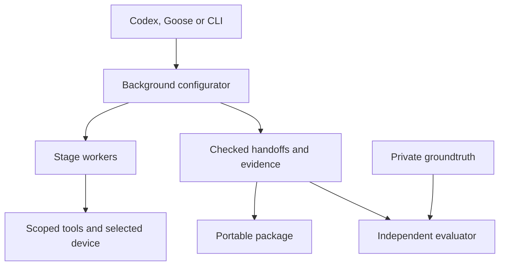
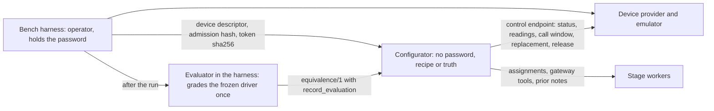

# Accepted design

Current runs use `assistive/1`: stage handoffs carry notes, device differences drive bounded repair, and one final equivalence verdict follows fresh reuse. The [amendment below](#assistive-protocol-amendment--2026-10-07) governs current behavior; the original design records the earlier gated protocol. Results from the two protocols are separate series.

Native execution variants also pin an `execution_setup`: method, actual executable, substitutions, validated behavior and hardware gaps. Acquisition, interpretation, provider and evaluator use that same artifact through the existing registry and lifecycle. A host ELF and an ARM image have distinct identities. The optional Zephyr native backend requires Linux; the core remains portable. Its process pauses leave the host clock running, so native clock pacing catches up on resume. Request/state comparison does not establish timing equivalence. Native admission additionally requires retained native/Renode comparison evidence and fresh reference/mutant calibration.

## Original design — 2026-10-03

Confirmed 2026-10-03; transaction evaluation amended October 5. Install Generative Driver, connect a supported device, state an objective, and get a portable driver with evidence. The core targets native macOS and Windows 11+. Optional analysis tools may use containers.

## Workflow

Acquire → interpret → probe → ground → emit → reuse. One stage runs at a time. A fresh agent must use the emitted package successfully, and independent checks must accept its behavior. Worker completion alone never advances a stage.

The configurator owns workers, exclusive device access and durable runs. UI reconnection uses the same run ID. Codex and Goose launch configured command-line runtimes under one stage contract; runtime, provider and model identities are recorded separately. State and outputs live outside the installed package.

Assignments, reports, acceptance checks and routing are separate records. Accepted artifacts are immutable and hash-pinned. Model defects return to interpretation; host and operator faults wait for the relevant correction. Diagnostic feedback allows at most two repairs before emission. Independent final checks grade the frozen package; final failure is terminal.

## Device access and recovery

The operator selects bindings and effect grants. Operations are bounded. Cancellation stops dispatch and records outstanding outcomes; an interrupted write stays uncertain and is never silently repeated.

Before final grading, an owned emulator may be replaced only when every unresolved effectful dispatch has trusted, completed model-failure evidence. The old process must be confirmed stopped, a distinct replacement independently verified at its initial state, and repair budget available. Retain failed commands and historical uncertainty. Physical or attached sessions, unknown/host/operator failures, cancellation, lost ownership, failed replacement verification and exhausted budgets remain blocked.

Blind interpretation receives its prepared inputs and generic tools. Fresh reuse receives only the package, objective and permitted operating information. Exclude the developer chat, private answers and prior candidates from fresh worker inputs; authorized repair feedback stays within its run. Record restrictions actually enforced. Encrypted truth and hashes provide evaluator separation and integrity, not an operating-system sandbox. Passwords stay outside candidate prompts, environments and workspaces.

## Repository and integrations

`src/generative_driver/` contains the configurator, tools, runtime and packaged resources. `plugins/` supplies Codex/Goose integration; `docs/`, `tests/` and `bench/` hold guides, behavior tests and benchmark instructions. Original code is Apache-2.0. Preserve third-party notices and the source research checkout; import only selected reusable material.

Generic tools and skills ship to workers. Sources, answers, scorers and historical outputs stay evaluator-side. Codex uses plugin/MCP wiring; Goose uses a recipe and MCP. Both connect to the same configurator. Follow [setup](setup.md) through runtime configuration, dependency checks and installation smoke before a device trial.

## Driver contracts and generated MCP — 2026-10-28

The [extension guide](extending-drivers-and-mcp.md) and [accepted contract design](superpowers/specs/2026-10-28-driver-contract-mcp-design.md) define the public driver contract, declarative protocol and supported application SDK. The contract supplies operation/field meanings, caveats and executable preconditions. Device-specific executable plugins remain outside the driver format; new behavior uses a shared runtime capability or a higher-level application tool.

Format-2 emission freezes the contract, protocol, executable projection and derived MCP catalog. Generic and benchmark fresh reuse use that catalog through configurator-owned dispatch. Current `assistive/1` handoffs retain notes; final equivalence additionally requires observed generated-tool use of the unchanged package. Benchmark passwords and final grading stay in the bench harness, after the run. Historical format-1 packages and reports retain their original meaning.

The [preserved nine-trial result](../bench/evidence/2026-10-29-driver-contract-mcp-verification.json) belongs to its pinned r2 release under the earlier gated workflow. Current-main integration is checked separately; that old result does not qualify a new runtime or evaluator.

## Evaluation

| Profile | Evidence |
|---|---|
| Installation smoke | Scripted workers and recorded replay; no inference or hardware; excluded from model scores |
| Emulated firmware | Actual agents on stable TQ9, sampled-sensor or parameter-store images; independent readings, effects and state checks |
| Physical BME280 | Explicit adapter and fresh operator references; agreement within supplied uncertainty, not absolute calibration |

Success requires all six gates, a fresh worker's package-only mission and independent final behavior. Functional equivalence means expected outputs and effects for supported inputs within declared tolerances; candidate code need not resemble reference code. Protocol validity alone proves neither meaning nor safe state sequencing. Keep failed, blocked, unrun and inapplicable stages visible.

Groundtruth includes source/build provenance, pinned inputs, auditable vectors, independent reference observations, expected outcomes and deliberately wrong models the evaluator must reject. Passwords are supplied separately to the human evaluator.

Store version 5 requires six diagnostic and final scenarios: idle update, pending same-bank update, pending different-bank update, stage/commit, stage/abort and rejection. Update discards pending edits in either bank, changes only the requested committed cell, preserves other cells, advances generation once and ends idle. Observe complete ending state. Rejection requires captured bytes matching an authenticated, independent complete-response witness; candidate delimiters and reject prefixes are insufficient. Equivalent request encodings remain valid. Earlier version 3 trials retain their original coverage.

Reports retain execution status, accepted stages and evaluator verdict separately, plus case/evaluator/toolchain/skill identities, runtime/provider/model/settings, budgets, environment, artifact hashes, attempts, false capability claims, time, managed calls, usage and interventions. Missing usage stays unknown. Comparisons changing multiple dimensions are labelled system comparisons.

Development mode runs one trial. The default repeated suite plans three families × three fresh repetitions: nine trials. Preserve individual outcomes and report success counts and time/usage coverage. Software and native reference checks do not establish model performance. See [benchmark use](../bench/README.md) and [measured verification](verification.md).

## Public test seams

Use one failing behavior test and its implementation at a time for code changes.

| Seam | Required behavior |
|---|---|
| Installed CLI/MCP | Clean install outside checkout, paths with spaces, setup smoke, optional-dependency reporting |
| Configurator/workers | Correct context/tools; checked advancement; duplicate/stale/tampered input rejection; durable reconnect, cancellation, recovery and fresh reuse |
| Runtime/package | Binding and grant checks before I/O; exclusive access; relocation, replay, tamper rejection; no automatic uncertain-write retry |
| Benchmark run/score/compare | Correct reference/mutant verdicts; six gates; explicit missing/incompatible data; frozen package and fresh use required |

Exercise actual public process/protocol boundaries. Controlled workers, clocks and devices support deterministic tests but remain labelled substitutes. Qualify native macOS/Windows releases separately from optional backends and physical devices.

## Assistive protocol amendment — 2026-10-07

New runs record `protocol: "assistive/1"`. For these runs this amendment supersedes the checked stage progression above: "deterministic checks control whether reports become accepted handoffs", "assignments advance only after checked reports", diagnostic observations as repair input, the six acceptance gates as the success criterion, the terminal frozen-final failure, and a configurator that unlocks truth to own the emulator. Earlier runs keep their recorded meaning; resuming one is refused, and assistive results are a new series that is not compared with gated results.

The configurator coordinates; for an emulated benchmark, a bench harness plays the operator:

- **Every stage hands off.** It passes on its observed artifacts, their hashes and a hashed `notes.json` (`stage-notes/1`): the worker's own checks, including failed and not-run ones, the configurator's truth-free checks, dropped claims, tool refusals and open questions. A stage that produced nothing usable hands off empty with its notes, and the next stage starts. Generic emit receives the latest interpreted model that wrote a successful probe record, from probe or ground, with that record, and hands off only a package the configurator observed: one `emit_package` built in its assignment, hashed when the tool returned, or bytes it gave to `emit_check`; a worker report may name which package, never its hash. Benchmark emit hands off only a package `emit_package` built in its assignment, by the hash recorded when the tool returned, that passes `emit_check`: a package the worker wrote or changed is dropped with a note and never graded. Fresh reuse receives only the emitted package, the objective and permitted operating information, never notes.
- **Only safety, integrity, operator and host faults stop a run.** Safety covers effect grants, the reset rule, uncertain writes and binding conflicts. Integrity covers a recorded or observed hash that changed and a changed sealed input. Operator covers cancellation, budget, a runtime that cannot start and a missing binding. Host covers a crashed runtime or configurator; it is resumable. Worker report content never stops a run.
- **The device drives repair.** Differences between the model and what the configurator observed on its own device connection during probe or ground return to interpret within the repair budget, together with the defects the configurator's own validation finds in the assigned model (structural failures are refused by the runtime; candidate response checks also reject a receive bound that cannot contain its declared rejection and completion, and the managed gateway refuses that candidate before contact). Each probe record a stage hands on is bound in its notes to the model that wrote it, and a later stage compares a record with its assigned model only when that model wrote it; a record of a worker's own variant says nothing about the assigned model. The gateway reads the model of every device dispatch as the runtime does and refuses one its strict bounded reader cannot load, and an effectful operation of an interface model that fails validation, before it marks the dispatch uncertain; `probe_run` and `interface_execute` declare the checks they make before the transport opens (model bytes, validation, operation, sample count, evidence bound, replay fixture, and a register probe's binding, grants and a model the register runtime cannot load or drive) as refusals with `transport_open_attempted: false`, so none of these leaves an effect to reconcile; nor does a host fault a tool declares before contact. Probe and ground workers are not given `model_validate`, which may write beside the model it checks. When the budget is spent the run continues with the best revision.
- **One final verdict.** After reuse the run records `equivalence: {equivalent, basis, checks, diff}` once, as verdict `<run_id>:final`, and ends `completed` whether or not the driver is equivalent. A restart or resume never grades again, cancellation never replaces the completed status, and a sealing or cleanup failure after the verdict is recorded as an event without erasing it; an uncertain effect still blocks for safety. A generic run's verdict is labelled `self-evidence` and is not an independent grade. It is equivalent when the emitted package passed `emit_check` replay of the recorded device exchanges, every live operation of fresh reuse succeeded, and at least one of them ran the frozen package with `emit_test_live` on the configurator-supplied connection, including a function beyond its identity operation, that is an operation with a step that asks the device something identity's own steps do not, compared by what reaches the device (op and tx, and a USB control transfer's setup and requested length): identity alone is not evidence of function, nor is an operation that only waits or repeats identity's requests, however it reads or checks the reply. A replay is one of recorded device exchanges only when the package's probe evidence was recorded live; a replay of exchanges the worker supplied does not count, nor does a seeded package-versus-model check, which compares a package with its own model, not the device. The frozen package ran when the configurator hashed its bytes before dispatch and the snapshot the tool executed carries the frozen manifest. Fresh reuse is every reuse attempt that received the frozen package, including one that stopped and was resumed; each attempt's notes judge its live operations by the same rule. A call or operation refused before the device was contacted, as the runtime or the tool declares, is not a live operation; a host fault the tool declares before contact (such as a snapshot copy it cannot read back) is no refusal and leaves the verdict unscored, and any other toolchain error may have followed device contact and leaves it unscored too; a tool that cannot record what the device did still returns it. A host fault in the configurator's own `emit_check` stops the run for the host at emit, resumably, and never rejects the package. Only a named failure outside the package bytes is a host fault (a file or process failure around the check, such as reading back its own snapshot copy, or a replay process that ends without a result or cannot read the verified snapshot, an import, memory or a timeout); a package the worker wrote, however malformed, is rejected, including a register converter that will not load, and the check keeps its records outside the worker's workspace. When the operator's grants permit no function of the frozen package (each needs an effect that was not granted, or its channel resets the device on open and the reset was not granted, so its runtime refuses every operation), fresh reuse cannot test one and the verdict is unscored, not not equivalent. A package whose runtime needs the reset grant refuses a live probe of its bytes too, so its missing replay of device exchanges is that limit as well. So is it when the gateway refused every connection to the run's device for the operator or the host, from which no live probe could be recorded either: no device bound, or a serial device without a reset grant that was observed resetting on open or whose every listen failed for the operator, the host or the transport. These limits excuse only the one package that passed `emit_check` without a replay of device exchanges; no driver emitted, a candidate `emit_check` rejected offline, or several packages handed off is not equivalent whatever the device access. Listening needs no grant, so a serial device no worker listened to is the pipeline's own omission and excuses nothing. Reachability is judged by the run's binding state as of fresh reuse, so an operator observation recorded later never turns a refused connection into a verdict about the driver. A failure the runtime attributes to the driver after the device opened makes the run not equivalent when the operation ran the frozen bytes (the package, or its driver directory as a model); a failure of other bytes, an operator, host or transport fault, or a dispatch whose result was never recorded, leaves it unscored. A run stopped after fresh reuse resumes to finalize without a budget or device lease, since finalize contacts no device; a restart completes a benchmark run there awaiting its grade unless an effect is uncertain, and an uncertain effect on a run awaiting its grade blocks it for safety until the operator reconciles it and resumes. For a generic run, a host failure to read the frozen package at finalize stops the run for the host instead of grading the driver. A gateway call dispatches only while its assignment is the run's active one, and a stage is observed and committed only after every call of it has left the gateway.
- **Benchmark stages see no truth.** Benchmark runs are graded by the evaluator once, after the run, with basis `evaluator`. Every benchmark case, legacy tq9 and bme280 included, observes its stages without the evaluator or the truth: instrument readings of the emulated device are device evidence that workers see and nothing grades, the repair input is the device difference only (including the configurator's validation of an interpreted model the emulator cannot carry), and the run completes with `progress.equivalence = "pending"`.
- **Recovery.** At any stage, the provider's verified replacement of the emulator after a write the runtime attributed to the model commits with that stage's handoff, together with the replacement's session and binding, whose lease replaces the stopped emulator's; this resolves the write without re-executing it; the recovery uses a repair only when the stage's device difference revises, so a spent budget never refuses it, and a recovery that does not commit is recorded as failed and leaves the write uncertain. A write the frozen driver fails during fresh reuse is evidence about the driver: reuse's handoff advances and the driver is graded after the run.
- **The harness holds the password; the configurator holds none.** A bench harness, one detached process per trial, plays the operator. It receives the evaluator password file path on stdin and never writes it down, admits the case, takes the device recipe from the truth, starts and owns the emulator through a device provider built from that recipe alone, and starts the configurator run with the device descriptor, the admission evidence hash and the sha256 of a random evaluation token. It keeps the token sealed under the password in its trial directory with the truth envelope's key derivation, so a resume can unlock it and the configurator's hash reveals nothing about the password. The configurator holds no password, recipe or truth: it refuses password and emulator options, compares the admission hash with the public pin and the device image with the pinned image, and reaches the device only through the provider's control endpoint (status, readings, the paused-between-calls window, replacement and release). Live calls take turns: each takes an instrument reading before and after the call, which runs inside the window. A provider that cannot be reached before a call refuses it, leaving nothing uncertain, and the stage stops for the operator. The run releases the device when it ends, once no live call is inside the window; the harness stops it, confirmed, and concludes only a run it saw finish and whose handoffs it read.
- **One grade after the run.** For a completed run the harness then grades the frozen driver the run accepted once, on a fresh emulator of its own: the package of the latest emit handoff that handed one on, with the mapping of the probe whose model it packages, each re-hashed. It seals `benchmark-run-evidence/2` in its trial directory and posts the public `equivalence/1` record (check ids with passed flags and the failing ids with a reason; expected values, tolerances and raw records stay sealed) with `record_evaluation`. The configurator records it once as the run's final verdict, basis `evaluator`, only with the run's evaluation token and under its case's grading method, for a completed run with nothing uncertain, and only about the run's accepted emitted package; an identical repeat changes nothing and any other is refused. No package is `no-driver`, no mapping is not equivalent, and a changed record (including accepted bytes that changed before the seal), an evaluator host fault or a record the configurator's `equivalence/1` schema would refuse is `unscored`, an event that leaves the run awaiting its grade; `benchmark trial-resume` completes such a trial and never grades a final the evaluator's draft already holds. It refuses a password that does not unlock the trial's token before it grades, seals or posts anything. The frozen package is graded by its own model bytes. Only one evaluation of a trial runs at a time. A stopped run's handoffs are sealed alone.
- **Resume and readings.** A stopped run resumes a stage only on a device that answers, healthy, with the session and binding the run recorded; otherwise it stops for the operator until the harness attaches a verified device with its evaluation token (`attach_device`), which the configurator checks against the pinned image and the device's own status. Nothing grades a run before it is terminal. Readings leave the provider as `instrument-observation/1` values and units; its startup readings and recovery proofs stay in its private journal under the harness's bench home, beside the configurator home, and each emulator session's own files (its log, monitor commands it rejected) in a private directory there that is removed once the session's stop is confirmed; the run records the device's session, binding and recovery receipts.
- **Suites.** A suite is driven by a bench harness too. The configurator only freezes and stores it, with the sha256 of the harness's token, and settles each slot from the child's status and recorded verdict, which it reads itself; the harness reserves each slot, provides the child's device, has the configurator start or resume the child, grades its frozen driver after the run and posts the verdict. The configurator starts or resumes a child only while the suite runs and within its budget, under the suite's lock, so a cancelled or spent suite starts and resumes none, and only from the frozen slot's request plus what the harness adds (the device, its admission and the token hash); a child request, or a run recorded under the slot's request, that differs blocks the suite. The same start or resume sent again after a lost reply finds the child it started or resumed, whatever the suite did since, and the harness keeps that child's device until the child has stopped. A child advances the suite only with a graded or no-driver verdict; an unscored or pending grade and every stop block it, and the suite counts equivalent drivers out of those planned. Password files and the emulator executable reach the harness on its stdin, never the suite tables. A resume relaunches the harness, which takes the suite over with a token of its own, attaches a device anew to a stopped child (never while an effect is uncertain), with an approved extension of that child's budget if one is given, and grades an unscored one once. Suites frozen before this, with password files or no scheduler, are read-only.
- **Reports.** An assistive benchmark run reports as `benchmark-report/3`, whose success is its recorded verdict; `score` grades the single final sealed in the trial's `benchmark-run-evidence/2` again, after checking it graded the run's accepted emitted driver under the run's snapshot. An assistive suite report counts equivalent drivers out of those planned, lists unscored trials and counts stops by category; each trial row gives its outcome, the reason, the stage where it stopped and the repairs it used, and a suite's status and events say why it stopped. Reports of different protocols are never aggregated or compared.
- **Legacy cases.** Legacy cases follow the same split. A tq9 run runs on an emulator its harness starts from the legacy recipe (the sensor model, the Renode setup and the PWM registers its instrument reads as a duty fraction); started without that device, its start says so and its device stages stop for the operator. A bme280 run uses the operator's bound device, which its harness never touches: the harness authenticates the evaluator password against the case truth before the run starts and follows the run while the operator supplies the reuse reference and resumes it, through any budget extension; `benchmark trial-resume` grades a run that completed after its harness stopped following it. A device diff in its probe or ground sends it back to interpretation with that diff and the candidate it contradicts as sealed inputs. Both are graded once after the run from the fresh reuse the run recorded (method `recorded-reuse`): tq9 against its sealed reuse goal, bme280 against the operator reference within the truth's age and tolerance limits; reuse calls that failed for the host or the operator before the goal was observed, or a reference outside those limits, are `unscored`. No stage grades, records a stage verdict or ends a run with a frozen-final failure; runs recorded with that earlier terminal failure stay terminal.
- **Limits of this protocol.** Workers see instrument readings, which include firmware-internal state (such as parameter-store cells and the sampled sensor's latched reference), so assistive results are not comparable with a protocol whose workers see only the device's interface. Workers are not read-isolated until a real sandbox exists: a worker running as the same user can read files outside its workspace, including the device control endpoint file, with which it could act on the device outside the configurator's record. That exposes no truth; separation from the answer keys stays password-based. The provided emulator (v2 families and legacy tq9) runs only inside each live call, probe included, and is paused between calls; probe objectives tell workers so. The case manifests' `time_policy.probe` text ("continuous emulator virtual time") is part of the pinned case and stays unchanged; it is not the provided device's policy. Only a suite's harness attaches a device to a stopped run, so a stopped single trial is not continued, and a trial whose emulator stop was never confirmed is not graded, since no command yet records the operator's reconciliation of that emulator. Every change under `benchmark_support` changes the evaluator implementation, and the recorded calibration was already stale at `52eb018`: a fresh native calibration must precede the nine-trial end test, and sealed evidence of an earlier revision, the 2/3 series included, regrades only from a preserved checkout of that revision.
