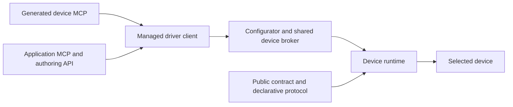

# Driver contracts, generated MCP and application tools

Current-main integration follows the accepted design’s `assistive/1` amendment: ordered handoffs retain evidence/notes; generated reuse and final equivalence remain required for success. The bench harness alone owns passwords and post-run grading. Historical gated benchmark results remain a separate series.

Design agreed through the October 28, 2026 grilling session. This document governs new driver contracts, device MCP generation and application MCP authoring. The [extension guide](../../extending-drivers-and-mcp.md) records the implemented format-1 subset and exact facade; qualification is tracked in the [execution ledger](../../../bench/evidence/2026-10-29-driver-contract-mcp-verification.json). [CONTEXT.md](../../../CONTEXT.md) defines the domain; [the accepted design](../../design.md) governs ownership, evaluation and recovery.

## Outcome and scope

Produce a portable, versioned driver whose public operation contract is sufficient to generate its MCP interface mechanically, including natural-language explanations. A downstream agent can add a device capability or build an application tool by following a supported interface, a runnable example and conformance checks.

Keep the six stages: acquire → interpret → probe → ground → emit → reuse. For new runs, emit includes the generated device MCP and reuse exercises it before independent final acceptance. Application tools are separately authored extensions; generating a driver does not invent application workflows.

## Agreed boundaries

| Component | Responsibility |
|---|---|
| Public driver contract | Operation identities, meanings, typed inputs/outputs, units, effects, execution rules, descriptions and scoped caveats. |
| Protocol implementation | Declarative transport settings, byte exchanges, encoding and decoding implementing those operations. |
| Device runtime | Validate and execute an implementation against its contract, with bounded behavior and shared runtime extensions. |
| Configurator | Own device access, operator bindings/grants, dispatch records, cancellation, uncertainty and reconnection. |
| Generated device MCP | Expose exactly one named tool per public operation and dispatch through the managed interface. |
| Application MCP layer | Compose public operations and calculations through the supported Python authoring API, with declarative tool schemas. |

New device implementations contain declarative models and shared, versioned runtime capabilities. Device-specific executable plugins are outside this format. Python orchestration belongs in the application layer; generic package entry points and shared runtime modules remain reusable code.

## Contract and implementation

Proposed persisted contracts are `driver-contract/1` and `driver-protocol/1`. Use strict, versioned JSON validation. Their serialization, version and registered runtime capabilities are explicit in the package manifest.

The public contract owns each operation's stable ID, descriptions, parameter and output definitions, effect category, preconditions and uncertainty records. Parameters carry bounded types and descriptions; known units are explicit and unknown units are labelled. Outputs have independent public value schemas instead of exposing decoder internals. Use a documented JSON Schema subset; reject unsupported constructs and resolve only packaged local references.

Each affected operation or parameter carries structured uncertainty records with a code, human-readable explanation and available evidence references. Preserve what is known, inferred or unknown without treating a source citation as an independent verdict. Missing meaning never removes an otherwise executable operation from the MCP catalog. Render its caveats into the operation/parameter descriptions. Proposed default: use the same mechanism for uncertainty about returned fields.

The protocol implementation references public operation and parameter IDs and supplies the wire behavior and value conversions. Keep parameter types, bounds, units and effects authoritative in the public contract. Any engine-specific executable view is derived and validated; a conflicting copy of public metadata fails validation. Internal representation and compilation strategy are builder choices.

Validate operation coverage, references, encoding compatibility, output types, runtime capabilities and execution bounds before dispatch. Numeric encoding bounds describe representable values; physical operating limits and accuracy require their own evidence. Unknown semantics remain visible and do not establish mission success.

Shared runtime extensions have registered capability IDs, versions, typed configuration, declared bounds and behavior tests. Models select registered capabilities; they do not name arbitrary import paths, execute expressions or load device-specific code. Optional hardware/analysis dependencies load when used. An unavailable capability yields a clear diagnostic with the operation still inspectable.

## Preconditions and results

Known, checkable preconditions are executable rules in the public contract. Proposed default: a bounded predicate language over validated parameters and fresh observations from declared read-only operations. Conditions support comparisons and finite boolean combinations; references and dependencies must validate without cycles. The runtime and configurator obtain observations and check conditions while holding the device's managed operation lease, before dispatching the requested command. A previous successful call alone does not establish the device's present state.

A false condition rejects the requested command. Failure to obtain an observation needed by a declared check returns an explicit inability-to-check result. An unknown prerequisite documented only as a semantic caveat remains a warning. Checking a condition may itself communicate with the device; distinguish those observations from dispatch of the requested command. State-changing preparation is an explicit operation, not an implicit guard repair.

Rejections expose the operation, condition ID and readable rule, reason, expected and observed values when available, and which commands were dispatched. Python, CLI and MCP preserve the same explanation. Runtime calls and generated tools provide no override; bypassing a precondition requires the user to modify the driver. Such a modification changes its identity and validation status.

Proposed shared result format is `driver-result/1`, with operation identity, success/failure, typed outputs, units, caveats, structured error details, package/contract identity and evidence/dispatch references. Define success and error variants so failures do not need fabricated success outputs. Record partial progress and outstanding effects separately from operation success. Keep semantic uncertainty distinct from uncertainty about a dispatched write. Preserve the existing operator/host/model fault routing.

## Managed use of finalized packages

Add a public package-use API backed by the existing configurator. Current calls through active stage assignments are insufficient for using a finalized package after its generation run ends. Factor shared lease, grant, dispatch and uncertain-effect handling so stage tools and finalized-package use have one owner and one implementation of these rules.

Proposed managed sessions pin a package, its accepted manifest and contract versions, a selected binding and operator effect grants. Session identities are explicit in managed requests and reconnect to the same owner; they are independent of worker assignments and MCP connections. The owner checks session validity, package pins and grants on every call. Operator configuration opens or changes a session; tool arguments cannot silently select another device or widen grants.

The public client must support contract inspection, named operation invocation, reading dispatch status/evidence, cancellation and closing/reconnecting to a session. Reconnection can read an outstanding result without repeating a command. Session recovery preserves uncertain effects and uses the existing reconciliation rules. Long-running calls have bounded dispatch status rather than relying on an MCP connection surviving.

Each public operation, including its bounded protocol steps and guard observations, holds exclusive managed access for its dispatch. An application workflow consists of individual managed calls and does not imply a transaction across all calls or devices. A sequence requiring one uninterrupted device lease belongs in a public driver operation. Application code checks cancellation before subsequent dispatch and preserves child results when it stops.

Proposed initial deployment is local stdio MCP backed by the installed core/configurator. Offline package inspection/replay remains available without optional hardware tools. Serving MCP and managed live use require the documented core runtime; neither requires firmware-analysis or emulator dependencies. Remote hosting and cross-device transactions are outside this release.

## MCP generation and application authoring

Use one renderer and one adapter for device and application tool specifications. A device tool derives its name, typed schemas, descriptions, caveats and precondition guidance from the accepted public operation. The renderer adds only documented common request context needed for managed dispatch. Use stable namespace prefixes, deterministic ordering and explicit collision rejection. Catalog identity includes the contract and renderer versions. The same pinned inputs produce the same tool definitions and explanations.

Serve typed structured results and a readable explanation through the installed MCP SDK. Map operation failures, including precondition rejections, to tool execution errors while retaining structured details and evidence references. Keep malformed protocol requests distinct. The adapter handles protocol-version details; the device contract remains independent of JSON-RPC framing. These choices follow the [MCP tools specification](https://modelcontextprotocol.io/specification/2026-07-28/server/tools) for schemas, structured content and execution errors.

Proposed public facade: `generative_driver.sdk`. It exposes a managed driver client, a tool-specification type, a per-invocation context and tool registration/serving helpers. Exact Python signatures are builder choices, provided the guide, template, generated adapter and tests use the same supported facade. Keep raw transport and private configurator imports behind this boundary.

An application tool declares its identity, input/output schemas, descriptions, caveats, driver-operation dependencies and required effects. Its Python implementation obtains scoped managed clients from the invocation context, invokes public operations and calculates its own outputs. The common adapter validates inputs and results, attaches constituent call/evidence references, preserves relevant caveats and reports child failures with their original condition explanations. The application cannot acquire additional device permissions by wrapping an operation.

The reference application is a bounded measurement average: take a declared number of measurements through a public operation, return the count and mean in the source unit, and retain source caveats and call references. It returns a failure with partial trace if a required measurement fails; alternative partial-result semantics must be explicitly declared by another tool. Calculating an average makes no new calibration claim.

## Proposed implementation seams

Names below are implementation defaults; keep the public ownership boundaries if internal files move.

| Location | Work |
|---|---|
| `src/interface_runtime/contracts.py` | Public/protocol validation, metadata references and public result definitions; independent of MCP imports. |
| `src/interface_runtime/conditions.py` | Predicate validation/evaluation against supplied observations; observation I/O remains owner-managed. |
| Existing engine, transports and codecs | Execute declarative implementations, validate public results and register bounded shared extensions. |
| Configurator plus a shared device-access component | Factor stage and package-session ownership, grants, leases, dispatch evidence, cancellation and recovery. |
| `src/generative_driver/sdk.py` | Supported authoring/client facade for generated and application tools. |
| `src/generative_driver/device_mcp.py` and common adapter | Generic catalog serving and SDK-backed registration/serialization. Keep the existing developer-facing generation MCP distinct. |
| Existing emit/package checks and resources | Package both contracts, shared runtime/entry points, derived catalog, reference, evidence and versioned integrity manifest. |
| Application template and `docs/extending-drivers-and-mcp.md` | Supported extension workflow and tested reference application. |

Generated per-device artifacts are data and shared entry-point templates. MCP hosting does not generate new device-specific Python logic. Package checks pin both authoritative contracts, declared runtime extensions and generated catalog; historical manifest checks retain their original version meaning.

## Six-stage integration

| Stage | Required change or evidence |
|---|---|
| Acquire | Preserve admissible source inputs and provenance. |
| Interpret | Produce the public contract and declarative implementation; explicitly record unknown semantics. |
| Probe | Exercise supported operations and declared checks, retaining protocol observations and caveats. |
| Ground | Check required meanings, outputs/effects and claims against independent observations under the existing evaluator boundary. |
| Emit | Validate the pair, generate MCP mechanically, run software conformance checks and freeze the complete package. |
| Reuse | A fresh worker discovers and uses the emitted MCP tools with only the package, objective and permitted operating information; independent checks accept the outputs/effects. |

For new contract/MCP runs, calling a generic internal package executor alone cannot satisfy fresh reuse. Route generated tool calls through the same managed dispatch and evaluator observation hooks, retaining tool identity and package pins. Frozen final grading and the existing diagnostic repair limits remain. Failures do not start an extra repair stage or silently mutate the final package.

## Documentation and acceptance

The extension guide has three branches: add a public operation using existing runtime capabilities; add a shared runtime capability; build an application MCP tool. Each branch names the supported entry points, artifact layout, version rules, required checks and a completion criterion. Ship concrete commands only when implemented, then execute those commands in tests. Link the guide from setup/developer entry points so downstream agents can find the appropriate branch.

Ship a versioned schema reference, reusable authoring template, generated device MCP example and the measurement-average application. They use the actual public facade and common adapter. Include examples of unknown units, a failed precondition and a constituent-call failure, with expected structured results and readable explanations.

Required observable checks across the existing public seams:

- **CLI/MCP:** clean installed use outside the checkout and in paths with spaces; actual stdio discovery/calls; one tool per operation; stable schemas/descriptions and collision diagnostics; clear missing optional dependencies; native macOS and Windows qualification reported separately.
- **Configurator/workers:** the same device owner for generated/application/stage calls; grant and package-pin enforcement; busy-device refusal; reconnect without re-dispatch; cancellation and uncertain-write recovery; isolated package-only reuse through generated tools.
- **Runtime/package:** strict contract/implementation matching; supported runtime capabilities; equivalent public Python/CLI/MCP outputs and failures; fresh guard observations; false/unavailable guard results; scoped warnings; relocation, replay, tamper detection and immutable final packages.
- **Application authoring:** run the template without private imports; validate schemas; preserve child errors, caveats and evidence; validate the average and its partial-failure/cancellation behavior. Shared test fixtures also check the generated adapter so documentation and implementation cannot drift independently.
- **Benchmark run/score/compare:** new manifests/evaluators identify MCP reuse as a requirement; reject a missing generic-only or fabricated mission; independently check effects; retain failed, blocked and unavailable results. Historical trials keep their original contracts, scores and labels.

Follow one failing behavior test, implementation and passing observation at a time for code changes. Software/replay checks are labelled as such. Model trials and physical operations require a separate explicit assignment; none are authorized by this design-writing session.

MHS conformance is a future compatibility question. This design specifies the project's driver contract and MCP integration without claiming conformance to a technical MHS specification.
